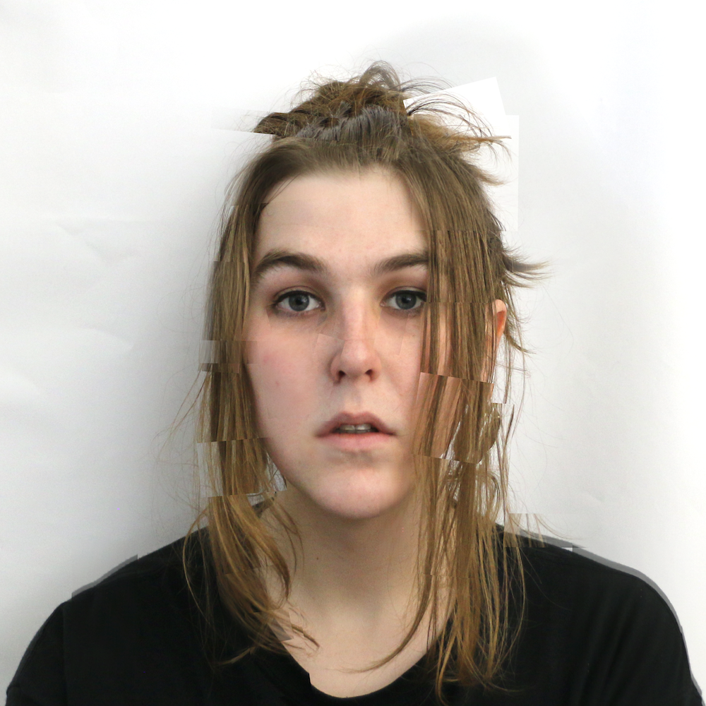

# About

remi caer is a soft cloud of static. She/They are a designer and artist based in Naarm, Australia. Her work explores the intersection between chaos and structure. Organising chaotic objects into structure. Using structured systems to create chaos.

## Education

Bachelor of Industrial Design with Honours, RMIT University, 2016–2021

## Design and Teaching

- Digital Teaching Assistant — RMIT University, 2020
- Research Assistant and Set Designer — RMIT University & Australian Dance Theatre, 2020–2021
- Studio Technician/Manager — RMIT University, 2019–2021
- University Lecturer — RMIT University, 2022–2024

## Art

- **Yellow** (2020–2021) — Testing Grounds
- **Phosphene** (2019) — SIGNAL Screen and Sound Commissions
- **COLD** (2019) — Collaboration with Jordan Lacey, Yarra Sculpture Gallery
- **Supernature** (2020–2021) — Production design for Australian Dance Theatre
- **Who is doing what to whom** (2022) — Production design for Thembi Soddell, The Big Anxiety Festival
- **Scopaesthesia** (2022) — Melbourne Fringe / Dublin Fringe
- **THE MONUMENTAL RUPTURE OF THE UN.DE.BAT.A.BLE CYCLE OF THE MO(U)RNING AND THE NIGHT.** (2023) — Production design for Chris Parkinson, VCA PhD Exhibition
- **Interstitial Dreaming** (2024) — Production design for Frankie Zhang, BLINDSIDE International Festival of Photography, Melbourne
- **Swamp** (2024) — Production design for Frankie Zhang, Run Artist Run

---

[Instagram](https://instagram.com/remi.caer) · [Email](mailto:remi.caer@icloud.com)
